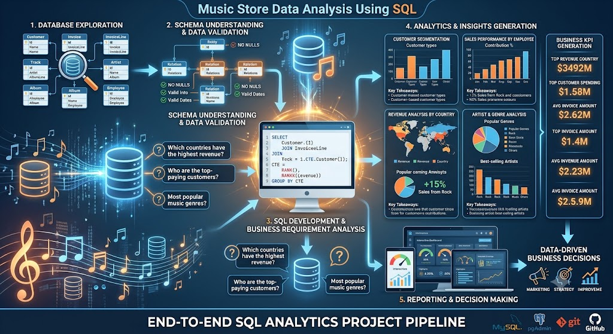

# 🎵 Music Store Data Analysis Using SQL

## 📌 Project Overview

**Music Store Data Analysis Using SQL** is an end-to-end data analytics project that leverages **Structured Query Language (SQL)** to extract meaningful business insights from a relational music store database. The project demonstrates how SQL can be used to analyze customer behavior, sales performance, employee productivity, and product trends, enabling data-driven business decision-making.

Designed around real-world business scenarios, this project showcases advanced SQL techniques, database querying, and analytical problem-solving skills commonly required in Data Analyst, Business Intelligence, and Data Science roles.

---

## 🎯 Business Problem

Music retailers generate large volumes of transactional data, making it challenging to identify sales trends, customer preferences, and business opportunities through manual analysis.

This project addresses these challenges by using SQL to answer critical business questions such as:

* Which countries generate the highest revenue?
* Who are the top-paying customers?
* Which music genres are most popular?
* Which employees contribute the most to sales?
* What are the best-selling artists and albums?
* How can customer purchasing behavior improve business strategies?

---

## 💡 Solution

Using a relational database and SQL, the project performs comprehensive business analysis by querying multiple interconnected tables and transforming raw transactional data into actionable insights.

The analysis includes:

* Database Exploration
* Data Cleaning
* Data Retrieval
* Business KPI Analysis
* Customer Segmentation
* Sales Performance Analysis
* Revenue Analysis
* Artist & Genre Analysis
* Advanced SQL Queries
* Business Reporting

---

## ⚙️ Key Features

* ✅ Real-World Business Case Study
* ✅ Relational Database Analysis
* ✅ Complex SQL Querying
* ✅ Multi-Table Joins
* ✅ Aggregations & Grouping
* ✅ Common Table Expressions (CTEs)
* ✅ Window Functions
* ✅ Subqueries
* ✅ Business KPI Reporting
* ✅ Data-Driven Decision Making

---

## 🛠️ Tech Stack

### Programming Language

* SQL

### Database

*  MySQL

### SQL Concepts

* SELECT Statements
* JOIN Operations
* GROUP BY & HAVING
* Aggregate Functions
* CASE Statements
* Common Table Expressions (CTEs)
* Window Functions
* Subqueries
* Views
* Ranking Functions

### Tools

* pgAdmin / MySQL Workbench / SQLite
* Git
* GitHub

---

## 📊 Project Workflow

1. Database Exploration
2. Schema Understanding
3. Data Validation
4. Business Requirement Analysis
5. SQL Query Development
6. Data Aggregation
7. KPI Generation
8. Business Insight Extraction
9. Performance Analysis
10. Reporting & Documentation

---

## 📈 Expected Outcome

The project uncovers valuable insights into customer purchasing behavior, sales performance, artist popularity, and revenue generation. These insights help businesses optimize marketing strategies, improve customer retention, and support informed decision-making.

---

## 🌟 Project Highlights

* Real-World Retail Business Analysis
* End-to-End SQL Analytics Project
* Advanced SQL Querying
* Complex Multi-Table Joins
* Window Functions & CTEs
* Business KPI Dashboard Queries
* Customer & Sales Analytics
* Interview-Oriented SQL Case Study
* Clean & Well-Documented SQL Scripts

---

## 🎓 Skills Demonstrated

* SQL
* Relational Database Management
* Data Analysis
* Data Exploration
* Business Analytics
* Query Optimization
* Aggregate Functions
* Window Functions
* CTEs
* Subqueries
* Database Design Understanding
* Problem Solving
* Git & GitHub

---

## 💼 Why This Project Matters

SQL remains one of the most essential skills for **Data Analysts, Business Intelligence Analysts, Data Scientists, Analytics Engineers, and Database Developers**. This project demonstrates the ability to analyze real-world business data, write efficient SQL queries, and convert raw transactional information into actionable business insights.

This repository showcases practical experience in relational database analysis, advanced SQL techniques, business intelligence, and analytical thinking, making it an excellent portfolio project for **Data Analyst, Business Analyst, Data Scientist, BI Analyst, Analytics Engineer, and SQL Developer** roles.

  

